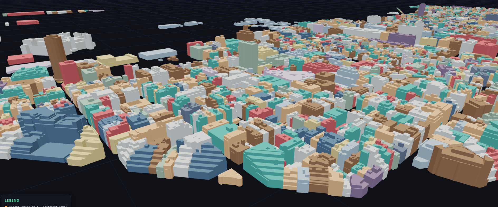
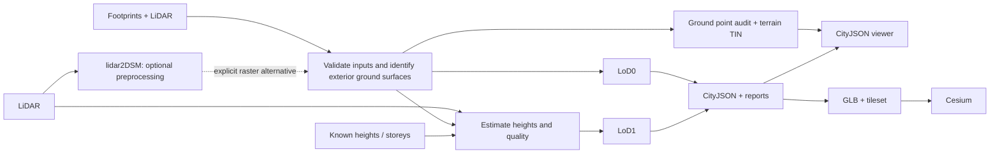

# 3DLodExt

**Turn footprints and LiDAR into CityJSON buildings and portable 3D files.**
A local command-line application with no database, container or authentication
requirement. The current workflow reconstructs **LoD0 and LoD1**.



The first **Road/Terrain/Forest/Water** surface stage is now available through
`build-surfaces`. It generates individual surfaces and reports, without scene
stitching. Start with [the surface tutorial](docs/surface_workflow.md).

The project's main purpose is traceable **building-height estimation**, retaining
genuine low terraces and separate bodies. CityJSON and tiles make those results
available for inspection and use. See [how it works](docs/how_it_works.md) and
[supported outputs and limits](docs/capabilities.md).

## What it does

Read building/part footprints from GeoPackage and LAS/LAZ/COPC point clouds. A compatible GeoTIFF DTM is an
explicit alternative ground source. Estimate ground and roof elevations, then reconstruct buildings
while preserving courtyards, concavities, disconnected components and source IDs.
Storey counts and known heights can support sparse LiDAR under explicit policies.

[Geometric surface attribution](docs/building_recovery.md) reconstructs
mapped buildings using coherent XYZ surfaces and neighbouring footprints,
including observations with incorrect provider labels. Original classes are metadata.

Optional [internal roof regions](docs/roof_regions.md) recover terraces and towers
within one received footprint. Several flat LoD1 volumes retain the original
source identity, with inferred boundaries and individual roof elevations recorded.

Outputs include CityJSON 2.0 per level, quality reports and a separate converter
to GLB and a static 3D Tiles 1.1 tileset for Cesium. Missing observations remain
visible in the report. An extrusion is never relabelled as LoD2.

## Quick start

To try the code on **real Las Canteras data**, follow [Reconstruct the promenade](docs/las_canteras.md#reconstruct-the-promenade).
The 7.95 MiB download contains cadastral footprints for 304 buildings and
original LiDAR returns along the waterfront. The tutorial takes you from those inputs to a CityJSON model
you can open and inspect. For a synthetic example, use the commands below.

From the repository root, using 64-bit Python 3.12 in PowerShell:

```powershell
python -m venv .venv
.\.venv\Scripts\python.exe -m pip install -c constraints/python312.txt ".[geo]"
.\.venv\Scripts\python.exe -m lodext build examples/first_run/build.lidar.json --output outputs/first-run
```

Open `outputs/first-run/model.lod1.city.json` in 3dLodViewer, Ninja or another
CityJSON viewer. For buildings and ground together, open `outputs/first-run/scene.lod1.city.json`.
The included synthetic dataset needs no private data download.
It contains a courtyard, low terrace, L-shaped body, disconnected components
and a part with sparse roof observations.

[Installation on Windows/Linux](docs/installation.md) ·
[Complete tutorial](docs/first_run.md) ·
[Ready-made model](examples/first_run/model.lod1.city.json) ·
[Build the documentation website](CONTRIBUTING.md#documentation-website).

## Inputs

| Input | Purpose |
|---|---|
| GeoPackage | XY footprints, source IDs and explicit building/part relationships |
| LAS/LAZ/COPC LiDAR | Ground and roof observations; source classes and selection evidence retained |
| Optional GeoTIFF DTM | Explicit raster-ground alternative; only this route can omit ground LiDAR for LoD0/known heights |
| JSON configuration | Paths, metric working CRS, shared vertical reference, levels and policies |
| Optional heights/storeys | Auxiliary evidence with method and provenance |

No precomputed area or 3DCityDB schema is required. See the
[executable input contract 0.2](docs/input_contract_v0_2.md) and
[command/configuration reference](docs/cli_reference.md).

[Direct ground sampling](docs/point_ground.md) needs no raster preprocessing.
It retains compact ground statistics and can write a terrain TIN for inspection.
Terrain export may be disabled when the viewer supplies its own DTM or terrain;
building base estimation is still performed. Point sampling is opt-in and
capped; the original clouds are not duplicated. For
applications that explicitly need a raster, the independent
[lidar2DSM tool](https://github.com/Fran-4c4/lidar2DSM) remains an optional
preprocessor; see [DTM preparation](docs/dtm_preparation.md).

## Outputs

```text
model.lod0.city.json   footprint surfaces at a representative ground base
model.lod1.city.json   solids per body, retaining courtyards and relationships
ground.sample.gpkg    optional capped point sample (disabled by default)
ground.city.json      optional observed-point terrain TIN, without faces through buildings
scene.lod1.city.json  optional buildings-and-terrain scene
quality.json          evidence, methods, exclusions and unresolved objects
objects.csv           review table
run.json              effective settings, versions and summary
```

Only requested levels are generated. Every run needs a new output directory.
Exit code 3 identifies partial results that require review. Input files and
previous runs are preserved. See [outputs](docs/outputs.md) and
[troubleshooting](docs/troubleshooting.md).

## Use the model in Cesium

Conversion is a separate step and can consume supported CityJSON without
re-estimating heights. **Only for this synthetic example**, an offset of -25
places its ground elevation 25 at ellipsoidal height zero:

```powershell
.\.venv\Scripts\python.exe -m lodext tiles outputs/first-run/model.lod1.city.json --output outputs/first-run-tiles --z-offset-m -25
```

This produces `model.glb`, `tileset.json` and `conversion.json`, ready for a
static HTTP server. Do not reuse that offset with real data. Building height,
vertical datum and viewer terrain placement are separate decisions. See
[Cesium placement and loading](docs/cesium.md).

## Workflow



Read the [reconstruction workflow](docs/how_it_works.md).

## Status and limitations

The converter emits one tile without semantic picking and requires an explicit vertical offset;
it performs neither a geoid transformation nor automatic terrain clamping.
Connected scene topology and LoD3 façades are not currently available.
See [supported outputs and limits](docs/capabilities.md).

## Documentation and licence

Start with the [documentation guide](docs/index.md). See
[CONTRIBUTING.md](CONTRIBUTING.md) for development and [AGENTS.md](AGENTS.md)
for portable agent rules. The engine does not require the 3dLodViewer repository.
Project documentation is maintained in English.

Original code, documentation and synthetic examples use [MIT](LICENSE).
Dependencies and validation schemas retain their own licences; see
[THIRD_PARTY.md](THIRD_PARTY.md).
