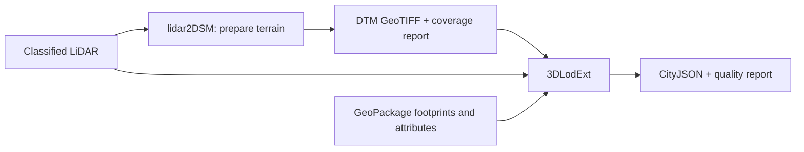

# Optional DTM preparation with lidar2DSM

The [direct point workflow](point_ground.md) reconstructs ground and buildings
without a DTM. If you explicitly need a terrain raster, use the independent
[lidar2DSM project](https://github.com/Fran-4c4/lidar2DSM) to prepare a DTM
GeoTIFF for the raster-ground workflow or other GIS applications. It is a separate preprocessing tool, not a
runtime dependency: 3DLodExt also accepts suitable DTMs from other sources.

New to the terminology? Read its introductory guide to
[DTM, DSM and nDSM](https://github.com/Fran-4c4/lidar2DSM/blob/main/docs/surface_models.md).
Use **DTM**, the ground-elevation raster, as the reconstruction input. DSM is
surface elevation, and nDSM is height above terrain; neither replaces a DTM.



## 1. Check the source data

- Ground points must already be classified, normally ASPRS class 2. lidar2DSM
  does not classify a cloud automatically.
- The LiDAR files must share a suitable projected CRS with horizontal units in
  metres, Z units in metres and a compatible vertical basis. lidar2DSM does not
  reproject or convert elevations.
- Keep ground observations around the buildings, not just inside their
  footprints. Reconstruction samples unobstructed surrounding terrain.
- A missing CRS requires an explicit, verified `crs_if_missing` declaration.
  Do not guess a CRS or assign one to disguise incompatible coordinates.

See the tool's [configuration contract](https://github.com/Fran-4c4/lidar2DSM/blob/main/docs/configuration.md)
for all options and validation rules.

## 2. Install the preprocessing tool separately

From the 3DLodExt root, these PowerShell commands create an isolated environment
under the ignored `work/` directory and install from the public repository:

```powershell
python -m venv work/lidar2dsm-env
.\work\lidar2dsm-env\Scripts\python.exe -m pip install "git+https://github.com/Fran-4c4/lidar2DSM.git"
```

This installation requires Git and network access. For a repeatable production
workflow, select a reviewed commit rather than relying on a moving branch.
On Linux, use `work/lidar2dsm-env/bin/python` instead. Native installation and
optional Docker instructions are maintained in the
[upstream guide](https://github.com/Fran-4c4/lidar2DSM/blob/main/docs/installation.md).
No source checkout needs to remain available after package installation.

## 3. Generate the terrain raster

For example, place your point clouds under `data/lidar/` and create
`data/prepare-dtm.json`:

```json
{
  "inputs": ["lidar"],
  "mode": "dtm",
  "resolution_m": 0.5,
  "radius_m": 1.0,
  "ground_classes": [2],
  "vertical_reference": "local_relative"
}
```

Input paths are relative to that JSON file. These resolution/radius values are
an example, not a universal quality recommendation. Choose them from actual
ground density and terrain conditions. The `local_relative` label explicitly
makes no absolute vertical-datum assertion; it does not establish compatibility
between unrelated surveys or transform their elevations.

```powershell
.\work\lidar2dsm-env\Scripts\python.exe -m lidar2dsm validate data/prepare-dtm.json
.\work\lidar2dsm-env\Scripts\python.exe -m lidar2dsm run data/prepare-dtm.json --output outputs/dtm-preparation
```

The output directory must be new. `validate` checks headers and the expected
grid; actual point support and coverage are checked during `run`.

## 4. Review coverage before reconstruction

The relevant outputs are:

| File | Review |
|---|---|
| `dtm.tif` | Ground elevations, CRS, grid and NoData. |
| `ground_count.tif` | Ground records inside each cell. |
| `dtm_support.tif` | Ground neighbours supporting each terrain estimate. |
| `run.json` | Effective settings, input sources, status, coverage and warnings. |

The DTM preserves the requested pixel size, including 0.5 m. This does not imply
0.5 m measurement accuracy. Cells without ground support inside the search
radius remain NoData; zero ground elevation is not a substitute.

For a building, the surrounding free area must contain enough valid terrain
for the reconstruction sampler. A completed raster conversion does not prove
that every building has usable ground support. Review the reconstruction's
quality report as well. See [output semantics](https://github.com/Fran-4c4/lidar2DSM/blob/main/docs/outputs.md)
and [measured validation limits](https://github.com/Fran-4c4/lidar2DSM/blob/main/docs/validation.md).

## 5. Supply the DTM to 3DLodExt

In your existing 3DLodExt build configuration, set `dtm` to the generated
GeoTIFF. For a configuration saved as `data/build.json`, the field would be:

```json
{
  "dtm": "../outputs/dtm-preparation/dtm.tif"
}
```

This is a field excerpt, not a complete build configuration. Keep the other
required inputs from the [input contract](input_contract_v0_2.md) and
[CLI reference](cli_reference.md). Preserve a compatible vertical basis between
the DTM and roof LiDAR. 3DLodExt can transform horizontal coordinates into the
declared working CRS, but does not transform Z or resolve an unknown datum.

```powershell
.\.venv\Scripts\python.exe -m lodext validate data/build.json
.\.venv\Scripts\python.exe -m lodext build data/build.json --output outputs/build-with-dtm
```

The preprocessing environment is not used by these reconstruction commands.
The two tools exchange local files; 3DLodExt does not import, download or launch
lidar2DSM at runtime.
