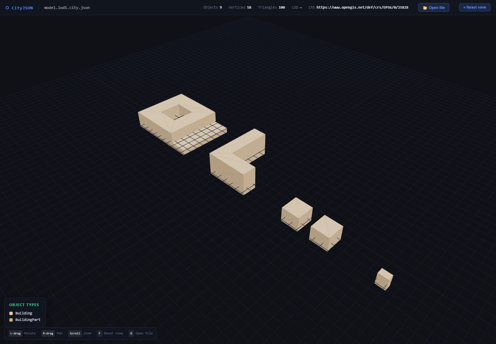
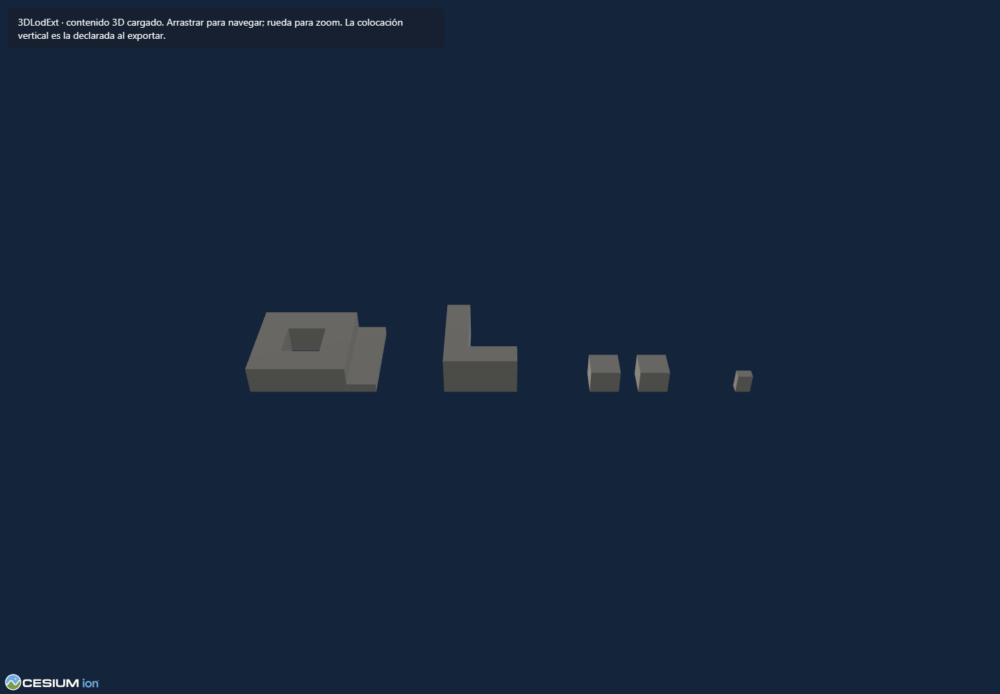

# First run: local files to a visible model

The included MIT synthetic dataset is approximately 320 KiB. It contains four
buildings and five parts: a courtyard, low terrace, concave body, disconnected
components and a body with only two roof points. These are generated data,
not a real survey. The original ground-point elevation is **25 m**. No DTM is required.

## 1. Install

Follow [installation](installation.md). Windows commands below invoke the
environment's Python directly. On Linux replace `.\.venv\Scripts\python.exe`
with `.venv/bin/python`. An activated environment can use `lodext` directly.

## 2. Inspect the inputs

Under `examples/first_run/`:

| File | Purpose |
|---|---|
| `footprints.gpkg` | `buildings` and `building_parts`, source IDs and relationships |
| `cloud.las` | Synthetic classified ground and roof points |
| `dtm.tif` | Optional synthetic raster for the explicit DTM variants |
| `build.lidar.json` | Direct point-ground/roof workflow with explicit external-height fallback |
| `build.json` | Preserved raster-ground variant |
| `truth.json` | Independent synthetic dimensions and target heights |
| `build.known.json` | Known-height variant without roof LiDAR |
| `build.lod0.json` | LoD0 surfaces without roof observations |

```powershell
.\.venv\Scripts\python.exe -m lodext validate examples/first_run/build.lidar.json
```

The declared `local_relative` vertical reference allows compatible local
elevations; it does not assert that source Z is ellipsoidal.

## 3. Build models

```powershell
.\.venv\Scripts\python.exe -m lodext build examples/first_run/build.lidar.json --output outputs/first-run
```

Use a new output directory. The engine identifies coherent exterior ground
points outside building footprints, samples roofs independently and
reconstructs each body. Expect
`status: complete`: four parts use LiDAR and one uses `external_height`.
The sparse body is resolved because this example explicitly enables
`external_height_fallback`. Its supplied height is reported as **input**,
not independent validation.

```text
outputs/first-run/
  model.lod0.city.json    surfaces without volume
  model.lod1.city.json    solids per part
  ground.sample.gpkg     optional capped diagnostic point sample
  ground.city.json       observed-point terrain TIN
  scene.lod1.city.json    buildings and ground together
  quality.json           evidence and status for every object
  objects.csv            review/comparison table
  run.json               effective configuration, versions and summary
```

Each building-only model has nine CityObjects: four semantic parents without duplicate
volumes and five parts. The disconnected part retains two solids under one
source identity. The combined scene adds one terrain object. See [output semantics](outputs.md).

## 4. Inspect CityJSON

Open `outputs/first-run/scene.lod1.city.json` in 3dLodViewer, Ninja or another
compatible viewer. On GitHub download the Raw file rather than its HTML page.
Ready-made models are also included:
[buildings](../examples/first_run/model.lod1.city.json) and
[buildings with ground](../examples/first_run/scene.lod1.city.json).

Check the open courtyard, low terrace, L shape, separated components and source
IDs/attributes. The base is 25, not zero. Inspect the original cloud in QGIS
when ground classification and a footprint disagree; an optional capped point
sample can also be requested. Separate files avoid superimposing
LoD0 and LoD1 in viewers without a level selector.

```powershell
.\.venv\Scripts\python.exe -m lodext validate-cityjson outputs/first-run/model.lod1.city.json
```

The command checks structure, relationships and closed shells. Figure 1 shows
the resulting model: the courtyard remains open and the terrace stays below
the main roof.



*Figure 1. Five reconstructed parts belonging to four buildings.*

## 5. Convert for Cesium

CityJSON cannot be passed directly to `Cesium3DTileset`. For this synthetic
example only, ground 25 is deliberately placed at ellipsoidal height zero:

```powershell
.\.venv\Scripts\python.exe -m lodext tiles outputs/first-run/model.lod1.city.json --output outputs/first-run-tiles --z-offset-m -25
```

This creates `model.glb`, `tileset.json` and `conversion.json` with relative URIs.
It preserves relative relief and does not clamp to terrain. **Never reuse -25
with real data** without an independently justified placement decision.
See [Cesium](cesium.md) for vertical placement and HTTP serving.

Serve the repository root:

```powershell
.\.venv\Scripts\python.exe -m http.server 8012 --bind 127.0.0.1 --directory .
```

Open `http://127.0.0.1:8012/examples/cesium-preview.html`. Only this preview
downloads CesiumJS from a CDN. The engine and generated files need no network.

Figure 2 shows the same model loaded as 3D Tiles.



## 6. Try other modes

```powershell
.\.venv\Scripts\python.exe -m lodext build examples/first_run/build.lod0.json --output outputs/only-lod0
.\.venv\Scripts\python.exe -m lodext build examples/first_run/build.known.json --output outputs/known-heights
.\.venv\Scripts\python.exe -m lodext demo --output work/new-demo
```

For your own data follow the [input contract](input_contract_v0_2.md) and
[configuration reference](cli_reference.md). Relative paths are resolved from
the configuration file.
