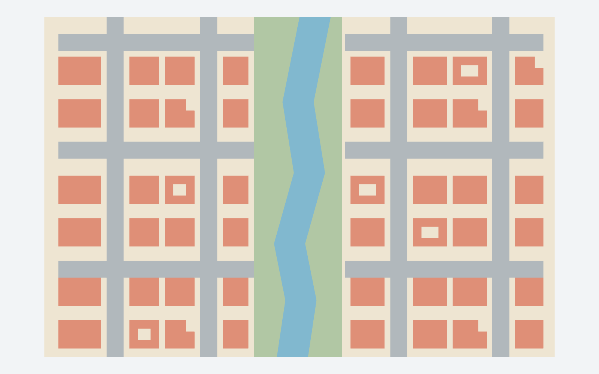
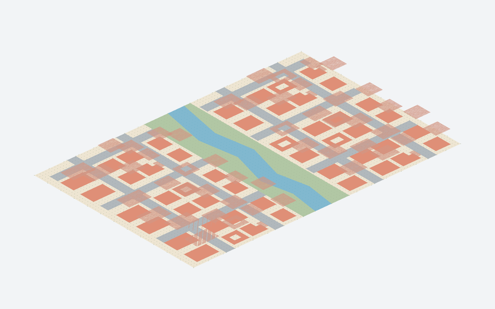
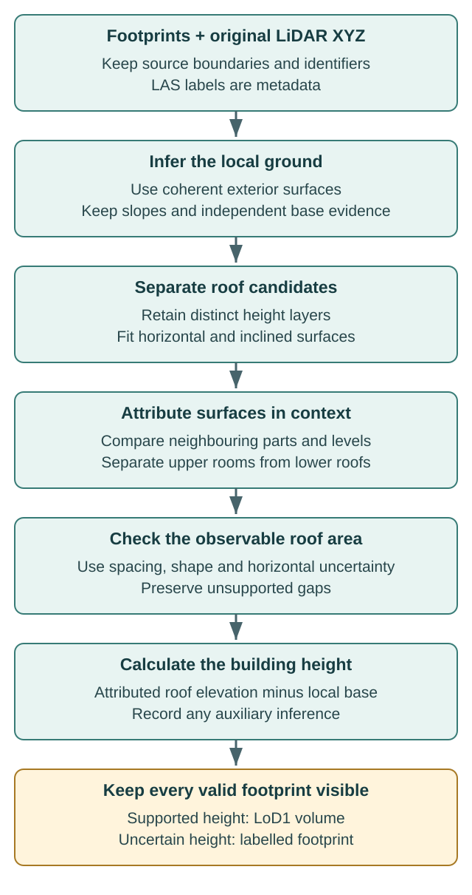
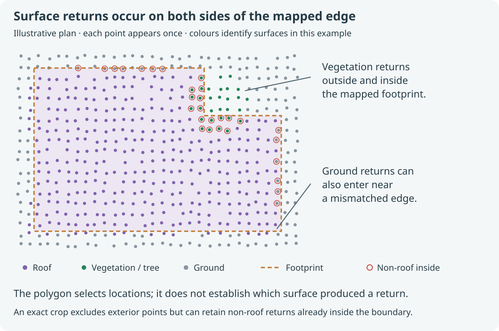
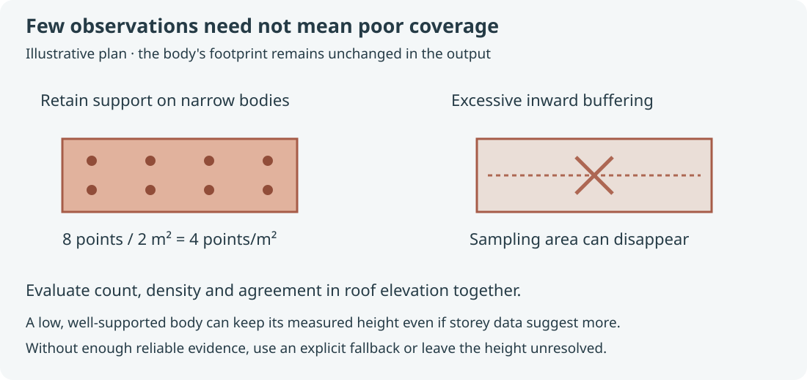
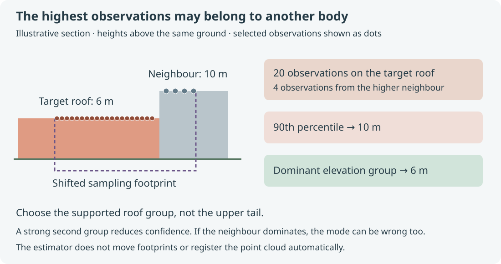
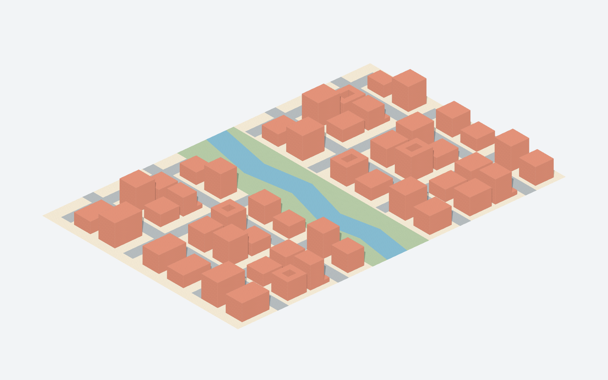

# How it works

3DLodExt combines GeoPackage polygons, LiDAR observations and terrain elevations
to construct building volumes and other geographic surfaces.

## 1. Define the objects

The GeoPackage defines where each object is and how it is classified. Building
parts describe bodies with different heights; a road polygon already contains
its width. Figure 1 shows the source map, including courtyards and the canal.

*Figure 1. Buildings in salmon, roads in grey, water in blue, forest-ground areas
in green and terrain in cream. These are synthetic polygons.*

## 2. Add elevation observations

LiDAR supplies XYZ observations. Footprints and surrounding geometry provide
context for attributing ground and roof surfaces. Observations must cover the surrounding
ground as well as roofs and share compatible vertical units and references. Figure 2 shows roof observations above the same
footprints. The roof grid is nominally 5 points/m²; the ground grid is separate.

*Figure 2. Roof observations are elevated above the map. This regular synthetic
cloud illustrates the inputs; real coverage and density vary within each object.*

## 3. Attribute surfaces in their neighbourhood

A point inside a footprint is a candidate, not proof of roof ownership. The
reader keeps all classes, separates coherent XYZ surfaces and compares them with
nearby building parts. Several spatially supported candidate planes can supply a roof;
a central rooftop room does not prevent using the exposed lower roof.

The flow separates exterior terrain from attributed roofs before calculating
height, as shown in Figure 3.

*Figure 3. Building decisions use XYZ, geometry and context. LAS labels remain
original metadata. The terrain TIN is a display output, not the base estimator.*

A supported upper part masks the area where a lower roof cannot be observed,
without cutting the main body's volume. Small parts retain their complete source
outline. Support depends on actual point spacing, footprint shape and horizontal
uncertainty; a global majority of mixed ground, roof and wall returns is not
required. Gaps between beams do not become a roof merely because a convex hull
can bridge them.

Ground is inferred from coherent exterior point surfaces, including slopes.
Height remains attributed roof elevation minus local base. Storey counts can
support explicit inference and contextual checks but cannot turn a neighbour's
height into a new observation. Missing evidence remains visible and uncertain.
See [surface attribution](building_recovery.md) and [point ground](point_ground.md).

### Points near a mapped edge

LiDAR samples surfaces at discrete locations. A mapped wall can fall between
returns, and imperfect agreement between datasets can leave roof, ground or tree
observations on either side of the outline. Figure 4 shows why an interior point
still needs surface attribution.

*Figure 4. Illustrative surface colours identify the roof, tree and ground in the
example; they are not trusted LAS classifications. Each point appears once.*

A narrow part can have few observations with good spatial support. Figure 5 shows
how an inward buffer can remove that evidence. Full-footprint attribution retains
the observations and checks their spacing, shape and elevation agreement.

*Figure 5. A small sampling area needs support appropriate to its size and shape.
The received outline remains unchanged.*

A neighbouring roof can also supply the highest observations inside the target
outline. Figure 6 illustrates how a height statistic can select that neighbour.
Geometry and neighbouring surfaces establish ownership before the roof elevation
is chosen; a dominant elevation alone is not proof.

*Figure 6. Illustrative input misalignment, not an automatic footprint shift.
A percentile or a mode can be misleading when competing surfaces are mixed.*

## 4. Construct the geometry

LoD0 represents the footprint at its ground elevation. LoD1 adds walls and a flat
roof for each body. Holes remain courtyards, and disconnected components keep
their identity. Figure 7 shows the generated volumes and surfaces.

*Figure 7. LoD1 buildings and lifted surfaces shown together. The ground is flat
in this example; automatic joining of neighbouring surfaces is not available.*

For other surface classes, elevation selection serves a different purpose:

- **Roads:** collect nearby observations around boundary vertices and choose the
  configured percentile. Optional filtering and smoothing reduce irregularities.
- **Terrain and forest ground:** lift the boundaries and retain observations
  inside the polygon, so a hill or depression does not disappear between its edges.
  Triangulation joins that elevation support into a surface.
- **Water:** choose one elevation from the selected observations and apply it
  across the object to produce a level surface.

Percentiles remain useful for these surfaces. Building surface attribution addresses
the separate problem of choosing a representative roof from mixed returns.

## 5. Inspect and use the result

Open the CityJSON model in a compatible viewer and review the low bodies,
courtyards and source IDs. Check `quality.json` or `objects.csv` for inferred,
excluded or unresolved objects before using the geometry in another application.
Convert CityJSON to GLB/3D Tiles when you want to load it in Cesium.

Continue with [your first model](first_run.md), [inspect the outputs](outputs.md)
or [explore the interactive example](examples.md#neighbourhood-example).
