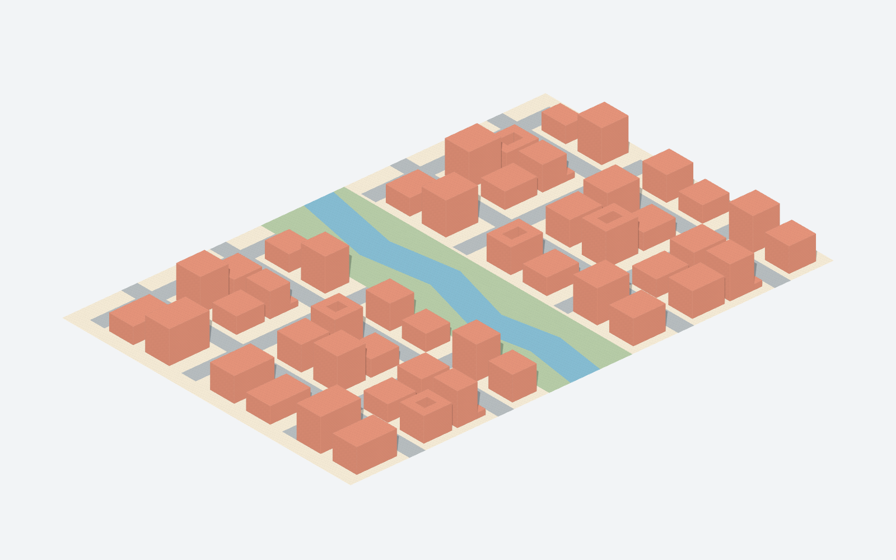
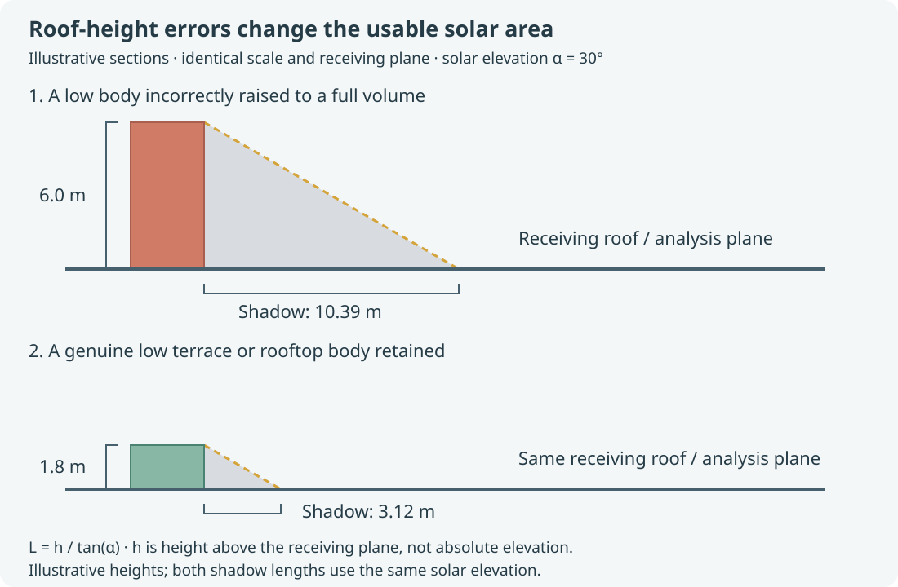
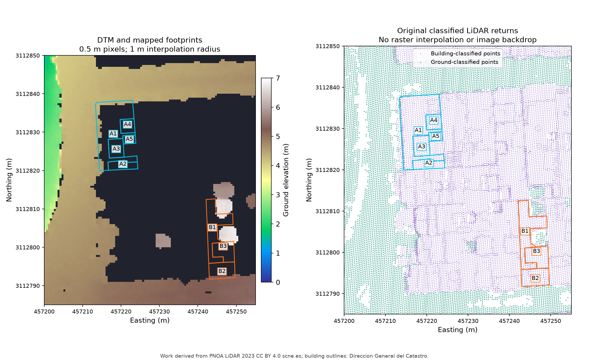
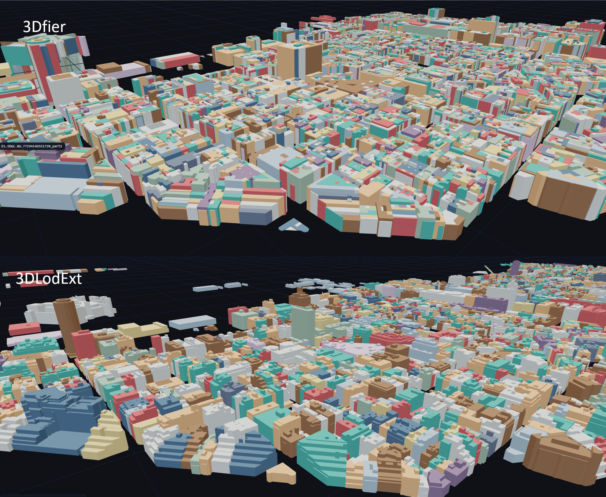

# 3DLodExt

**Create 3D building models from your GIS data.**

3DLodExt is a local command-line tool that turns building footprints in a
GeoPackage and LiDAR observations into 3D models of buildings and
ground. No terrain raster is required.
Use it to reconstruct building heights, inspect the results in a CityJSON viewer
or export them as 3D Tiles for Cesium.

It reconstructs each building or building part separately, preserving courtyards,
separate bodies and low terraces. Road, terrain, forest-ground and water polygons
can also be lifted into individual 3D surfaces. Figure 1 shows these outputs in
one synthetic neighbourhood: building volumes beside roads, green banks and water.

*Figure 1. Synthetic example generated with 3DLodExt. Buildings and surfaces are
shown together; their boundaries are not yet stitched into a continuous mesh.
[Explore the example](examples.md#neighbourhood-example).*

## Why building-part heights matter

A low terrace and a full-height building body must not become the same volume.
Raising a terrace to an invented storey creates a false obstruction, changing the
shadows that a downstream analysis would calculate on the roof. This can make
usable space appear unsuitable for solar panels or other rooftop equipment.
Figure 2 illustrates the effect of that height error under the same sun angle.

*Figure 2. A simplified section comparing a 6 m obstruction with a 1.8 m body,
measured above the receiving roof. Shadow analysis itself is performed in a
separate application.*

3DLodExt estimates ground from geometrically supported exterior LiDAR surfaces and
roof elevation from supported roof observations. It retains genuine low bodies and can use known heights or storey
counts when observations are insufficient. A quality report identifies inferred
heights and objects that could not be reconstructed.

## What you supply and receive

| Supply | Receive |
|---|---|
| GeoPackage footprints, IDs and optional building-part relationships | LoD0 footprint surfaces and LoD1 building volumes in CityJSON |
| LAS/LAZ/COPC LiDAR | Estimated ground/roof heights, compact ground evidence and a terrain TIN |
| Optional compatible DTM GeoTIFF | Explicit raster-ground alternative |
| Optional known heights or storey counts | Explicitly identified fallback heights |
| A JSON configuration with file paths and coordinate references | Optional GLB and 3D Tiles for viewing |

A GeoPackage provides the shapes; point coordinates provide the elevation
evidence. LoD0 and known-height modes do not need roof observations, but still
need ground. See [ground from LiDAR](point_ground.md). A supplied DTM explicitly
selects the raster-ground alternative.

LoD1 uses a flat roof for each body. Pitched-roof LoD2 reconstruction, bridges,
wall features and automatic scene stitching are not available in this version.
See [supported outputs and limits](capabilities.md).

## Real observations at Las Canteras

A mapped boundary does not necessarily separate the selected LiDAR elevations
into one roof plane. Ground interpolation can also extend raster support inside
that boundary. Figure 3 compares a real DTM with original classified points at
Las Canteras; the [worked example](las_canteras.md) explains the observations and
how they affect the reconstructed heights.

*Figure 3. Left: interpolated ground elevations. Right: original ground-classified
points in green and building-classified points in purple. Data: PNOA LiDAR 2023,
CC BY 4.0 scne.es; building outlines: Direccion General del Catastro.*

## Start with an example

[Install 3DLodExt](installation.md), then [generate your first model](first_run.md)
using the included small dataset. Once you have inspected that result, follow
[the guide for your own GeoPackage](your_data.md). No database or hosted account
is required; processing uses local files.

## Project origin

3DLodExt grew out of reconstruction work with
[3dfier](https://tudelft3d.github.io/3dfier/). Limited and uneven LiDAR support,
imperfect agreement with building footprints and mixtures of neighbouring roof
observations motivated additional sampling and height-estimation heuristics,
with particular attention to small bodies and low terraces.

Figure 4 shows how the two tools reconstruct the same area of Las Canteras.
Select the image to open the full-resolution comparison.

*Figure 4. Las Canteras reconstructed with 3dfier (top) and 3DLodExt (bottom).*

[Reconstruct a small section of the Las Canteras promenade](las_canteras.md#reconstruct-the-promenade)
with 3DLodExt and open the model generated from the supplied footprints and LiDAR.

Original project code and synthetic examples are available under [MIT](../LICENSE).
