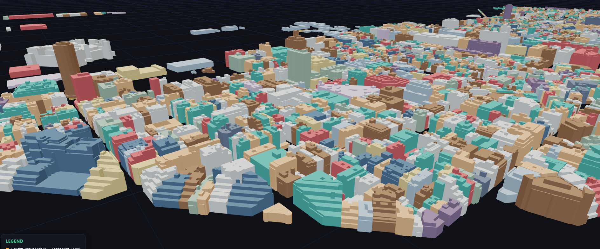
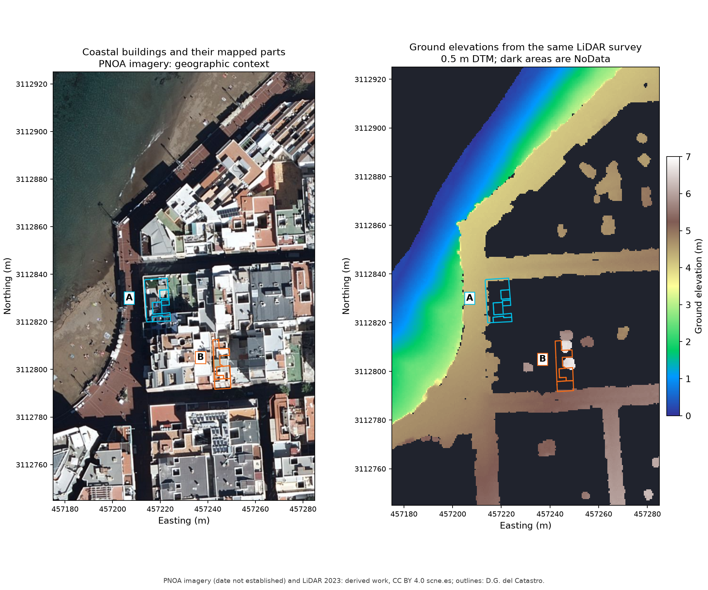
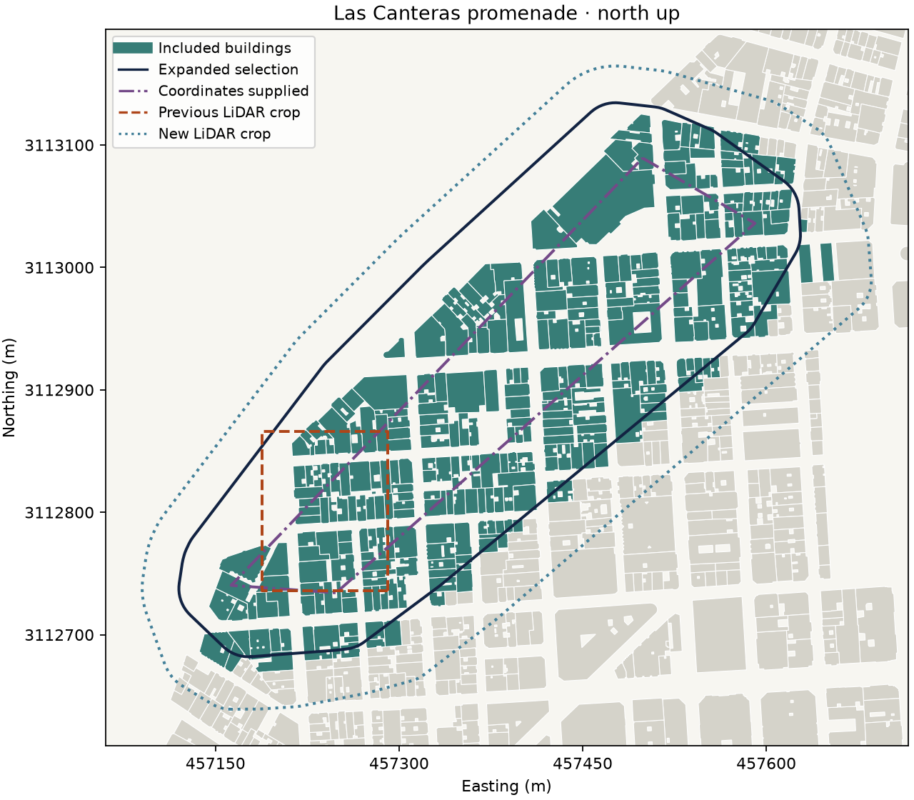
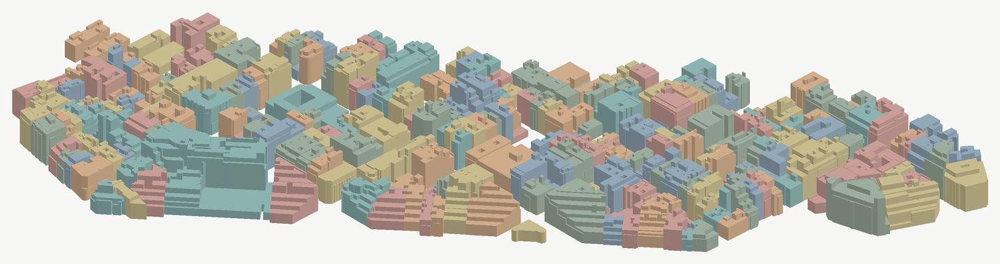
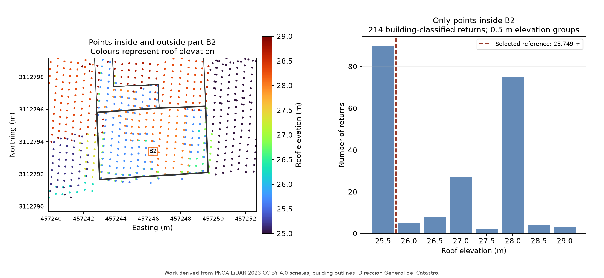
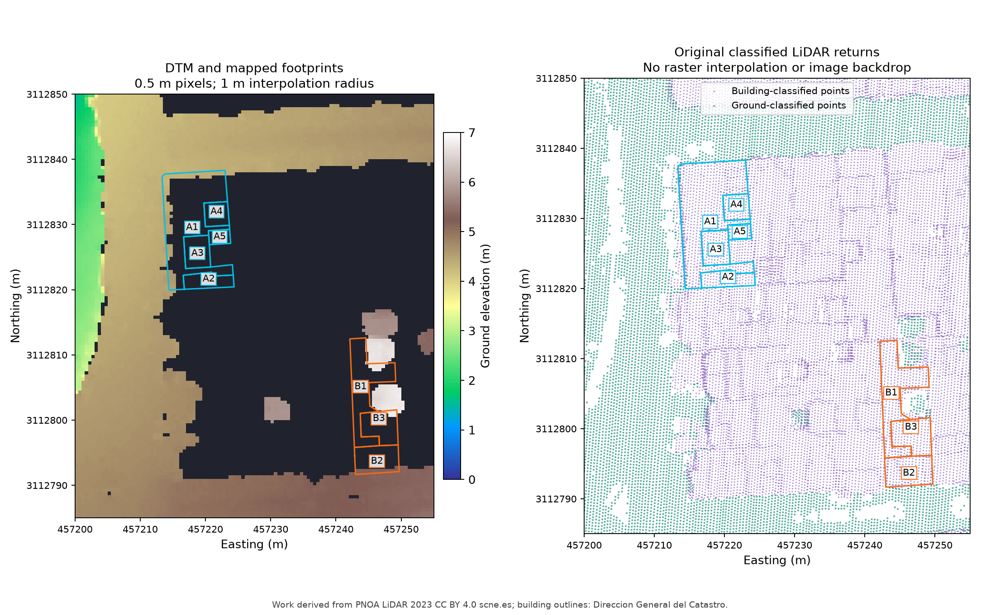

# Las Canteras: footprints, roof points and terrain

Building reconstruction depends on how well the observations describe each
mapped body. A dense group of points can still mix two roofs, and a valid DTM
cell can extend inside a footprint without a ground return there. These coastal
buildings at Las Canteras, Las Palmas de Gran Canaria, illustrate both problems.

The overview shows the larger Las Canteras reconstruction. The downloadable
example below covers a section of the waterfront that you can rebuild locally.
Select the overview, coverage map or example model image to open it at full size.

[](../examples/las_canteras/las-canteras-overview.png)

*Las Canteras overview. The stepped volumes along the waterfront show where
neighbouring building parts have different roof heights.*

The inputs are PNOA LiDAR from 2023 and cadastral building parts. A separate
0.5 m DTM generated from ground-classified returns illustrates raster support
in Figure 1; the height result below uses direct point-ground statistics. Figure 1 locates buildings **A** and
**B** beside the promenade. The ground raster shows the raised coastal platform,
the lower beach and gaps where ground observations are absent.



*Figure 1. Cyan outlines identify building A; orange identifies building B.
Both panels use EPSG:4083. The image supplies geographic context; the numerical
checks below use the DTM and point coordinates. Dark raster areas are NoData,
not ground at zero elevation.
[Full-size figure](../examples/las_canteras/coast-evidence.png).*

## Reconstruct the promenade

Download the [Las Canteras promenade inputs (7.95 MiB ZIP)](../examples/las_canteras/promenade.zip)
and extract the files together. The archive contains the cadastral GeoPackage,
a LAZ file with 981,412 original PNOA returns, a build configuration and source credits.
The inner quadrilateral follows approximately 485 m of waterfront. The building
selection extends 30 m beyond the outline enclosing that strip and the buildings
it intersects. It covers 11.01 hectares. All 304 buildings touching this larger
area retain their complete mapped parts. A further 30 m margin around the selection
and its buildings provides LiDAR observations of adjacent roofs and streets.

[](../examples/las_canteras/promenade-extent.png)

*North is up. Purple marks the approximate coastal strip and the dark outline
marks the expanded selection. Teal footprints are included in the download.
The dotted blue line bounds the LiDAR crop. The dashed orange rectangle locates
the earlier 103 × 130 m example. Coordinates are in EPSG:4083.*

After [installation](installation.md), activate the Python environment that
contains 3DLodExt. From the extracted directory, run:

```shell
lodext validate build.json
lodext build build.json --output model
```

Open `model/model.lod1.city.json` in a CityJSON viewer. The example produces
1,727 LoD1 volumes from 1,734 mapped parts. The other seven parts remain visible
as unresolved footprints, so the build reports a partial result (exit code 3).
The view below was rendered from that output.

[](../examples/las_canteras/promenade-model.png)

*Downloadable example viewed from the sea. Colours distinguish buildings;
stepped volumes within a building share its colour.*

Select
`BuildingPart::ES.SDGC.BU.7426322DS5172N_part2` (B2 in the figures) and find
its row in `model/objects.csv`. The example run places the base at 5.238 m and
the roof at 28.000 m, giving a height of 22.762 m. These are model estimates.
The crop supplies less neighbouring context than the city-wide run.

## A footprint can contain more than one roof elevation

Part **B2** contains 214 returns classified as building points. They form groups
near 25.5 m and 28 m. Figure 2 shows that the higher group continues across the
shared edge: cropping to B2 does not isolate one roof plane. Moving the sampling
boundary inward also leaves observations from both groups in this example.



*Figure 2. The left panel includes points outside B2 as well as inside it.
Point colours represent elevation, not vegetation or classification. The right
panel groups only B2's observations in 0.5 m elevation bins. The dashed line
marks the selected roof reference.
[Full-size figure](../examples/las_canteras/part2-point-ownership.png).*

A high percentile can select a neighbouring roof when enough of its points
fall inside the footprint. Choosing the dominant elevation group works when
one plane has clear support; competing groups require additional evidence.
Storey counts help relate B2 to measured parts of the same building, rather
than treating every high return as its roof.

Figure 2 records an earlier analysis of B2. It used the **25.749 m** roof
reference marked in the histogram and produced the following estimates.
Use the values in *Reconstruct the promenade* to check a run of the downloadable example.

| Quantity | Elevation or height |
|---|---:|
| Roof reference | 25.749 m |
| Ground elevation | 5.320 m |
| Height above ground | 20.429 m |

The ground estimate counts 568 original exterior ground returns. Its 0.01 m
Z-histogram step gives a numerical median error bound of 0.005 m, separate from
survey accuracy. No complete point copy is retained. See [ground from LiDAR](point_ground.md).

The storey reference helps distinguish plausible groups; it does not multiply
the final roof elevation. This outcome is reported as `roof_band`, retaining
the modal elevation, selected reference and supporting evidence separately.
It remains a contextual attribution, not a surveyed confirmation of the roof.

## What raster interpolation can change

The direct workflow retains point statistics rather than raster support. For
comparison with the source observations, the illustrated optional DTM uses
ground-classified points with a 1 m interpolation radius. Its cells
do not stop at a cadastral polygon. Figure 3 compares the raster directly with
the original point positions, without an image backdrop: some ground support
extends into the mapped building outlines.



*Figure 3. Left: 0.5 m DTM cells. Right: green ground-classified returns and
purple building-classified returns. Cyan and orange lines are the same supplied
footprints in both panels. Unlike Figure 2, point colours here denote classes.
[Full-size figure](../examples/las_canteras/dtm-footprint-support.png).*

Inside B2, **17 raster cells have valid ground elevations, although no original
ground-classified point lies inside its footprint**. All those cells have nearby
exterior ground support within the interpolation radius. For A1, 14 original
ground-classified points lie inside the boundary, no deeper than 0.41 m; valid
interpolated cells reach approximately 1.13 m inside.

This overlap does not establish that the footprints have shifted. Pixel spacing,
interpolation support, classification and source alignment must be considered
separately. For these eight parts, the GeoPackage preserves the original GML
geometry after the declared reprojection; no additional coordinate rounding
explains the overlap. That numerical check does not establish the absolute
positional accuracy of either source.

## Inspect a narrow terrace

Compare the original XYZ returns across the terrace and the adjacent roof. If only the outer edge has high returns, check which surface supplied the reported roof elevation in `quality.json`. Compare the base with exposed ground along the building. A standard LoD1 volume has one flat top. Where the cloud shows several roof levels within one footprint, inspect the [roof regions](roof_regions.md) option.

Follow [how it works](how_it_works.md) for the general method, or use the
[parameter examples](parameter_examples.md) to explore sampling and fallback
settings with downloadable datasets.

## Data sources

LiDAR: PNOA 2023. Building parts: Direccion General del Catastro INSPIRE,
snapshot dated 21 August 2026. The PNOA imagery acquisition date has not been
established and may differ from both. The 0.5 m DTM cell size is not a statement
of LiDAR point spacing. Roofs and ground retain the survey's original metre Z
values; no vertical-datum conversion is applied.

Figures are analytical works derived from PNOA data, **CC BY 4.0 scne.es**, and
building outlines supplied by **Direccion General del Catastro**. Their source
terms remain separate from the project's MIT code licence. See the
[figure credits](../examples/las_canteras/NOTICE.txt),
[source and measurement details](../examples/las_canteras/sources.json),
[IGN use conditions](https://www.ign.es/resources/licencia/Condiciones_licenciaUso_IGN_eng.pdf)
and [Catastro INSPIRE terms](https://www.catastro.hacienda.gob.es/webinspire/documentos/Licencia.pdf).
