# Parameter examples

Each comparison keeps the same XYZ and footprint geometry. Listed settings
change between variants; the classification comparison changes only LAS labels. Models and tables come from actual 3DLodExt runs; camera
position and scale are identical within each figure. The datasets are original
synthetic controls under MIT, not surveys or universal parameter recommendations.

## Run an example

Download a comparison's ZIP and extract it into a directory such as
`data/erosion-example/`. It contains GeoPackage/LAS/DTM inputs, configurations,
ready-made CityJSON models and evidence tables. After [installation](installation.md),
run from the repository root:

```powershell
.\.venv\Scripts\python.exe -m lodext build data/erosion-example/configs/half.json --output outputs/erosion-half-01
```

Choose a new output directory for each run. Deliberately unresolved variants
return exit code 3 with partial outputs. They are part of the comparison, not
installation failures. The road and water examples use `build-surfaces` instead
of `build`. Open a downloaded model in a CityJSON viewer, or use the interactive
comparisons linked below. The browser preview needs WebGL and downloads Three.js
from a CDN; reconstruction and static figures work with local files.

## Boundary uncertainty and edge contamination

A 10 × 10 m footprint contains a 6 m roof and higher observations near its
edges. The three runs change `building_surfaces.registration_m`: 0, 0.25 and
0.5 m. This horizontal uncertainty affects the geometric support test; it does
not translate or erode the exported footprint. The source area remains 100 m².

Figure 1 shows the generated volumes. Figure 2 shows source observations:
bright points are footprint candidates and faint points provide exterior
context. Colours show original LAS labels, not established surface ownership.

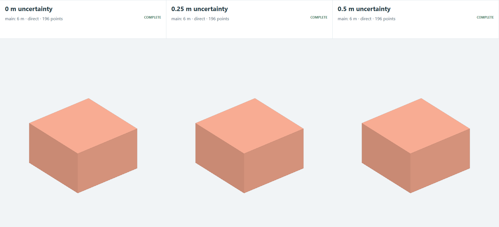

*Figure 1. A dashed footprint without a volume marks an unresolved body.*

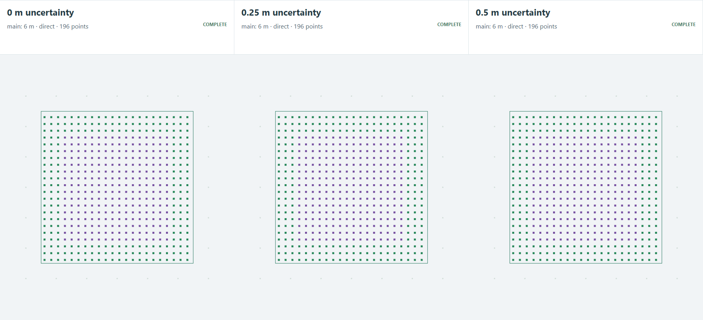

*Figure 2. Bright points are footprint candidates; faint points provide context. Colours are source labels, not roof ownership.*

| Variant | Body | Height above ground | Method | Roof points | Configuration | Model |
|---|---|---|---|---:|---|---|
| 0 m uncertainty | main | 6 m | LiDAR | 196 | [JSON](../examples/parameters/erosion/configs/none.json) | [CityJSON](../examples/parameters/erosion/models/none.city.json) |
| 0.25 m uncertainty | main | 6 m | LiDAR | 196 | [JSON](../examples/parameters/erosion/configs/half.json) | [CityJSON](../examples/parameters/erosion/models/half.city.json) |
| 0.5 m uncertainty | main | 6 m | LiDAR | 196 | [JSON](../examples/parameters/erosion/configs/one.json) | [CityJSON](../examples/parameters/erosion/models/one.city.json) |

[Download inputs, configurations and outputs](../examples/parameters/erosion/example.zip) · [Interactive comparison](../examples/parameters/preview.html?family=erosion)

## Building results are independent of LAS labels

The two LAS inputs contain identical XYZ. Only the original classifications
are replaced in the second file. Both runs reconstruct the same 6 m roof.
Figure 3 shows the unchanged geometry; Figure 4 shows the metadata colours
changing without deciding which points establish the building height.

Class labels are retained for provenance. No building class filter is applied.

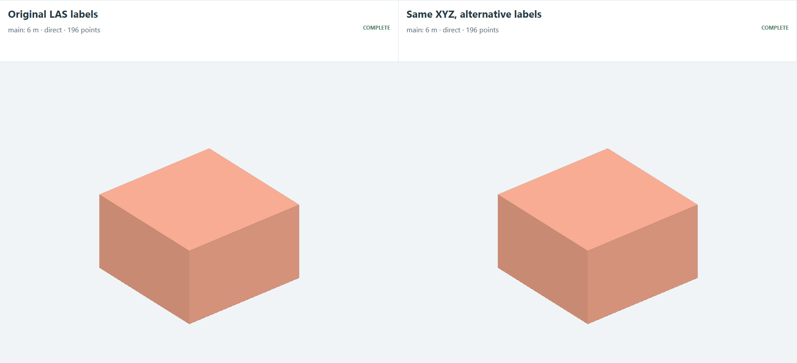

*Figure 3. A dashed footprint without a volume marks an unresolved body.*

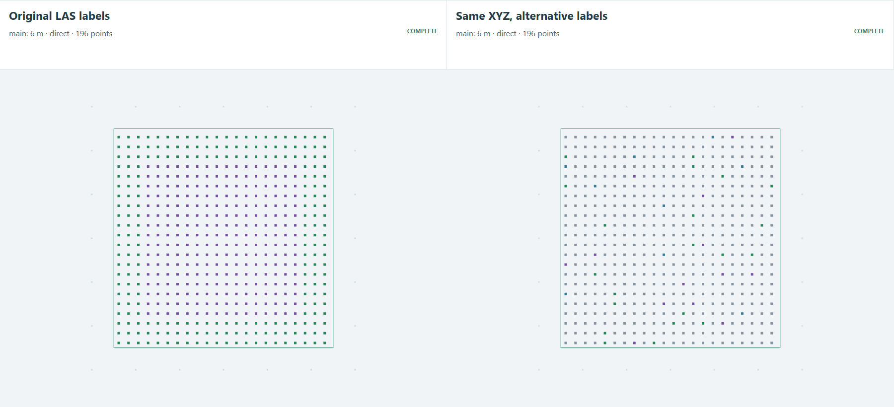

*Figure 4. Bright points are footprint candidates; faint points provide context. Colours are source labels, not roof ownership.*

| Variant | Body | Height above ground | Method | Roof points | Configuration | Model |
|---|---|---|---|---:|---|---|
| Original LAS labels | main | 6 m | LiDAR | 196 | [JSON](../examples/parameters/classes/configs/all.json) | [CityJSON](../examples/parameters/classes/models/all.city.json) |
| Same XYZ, alternative labels | main | 6 m | LiDAR | 196 | [JSON](../examples/parameters/classes/configs/roof.json) | [CityJSON](../examples/parameters/classes/models/roof.city.json) |

[Download inputs, configurations and outputs](../examples/parameters/classes/example.zip) · [Interactive comparison](../examples/parameters/preview.html?family=classes)

## Small bodies: spatial support and point count

A 2 m² low body has eight roof observations at 2 m above ground. Both runs
recover that height because the observations establish a coherent spatial
surface. The alternative density criterion changes the height-estimator route,
while the received shape and independently supported roof remain unchanged.
Figure 5 shows the result and Figure 6 the same footprint candidates.

A point count alone cannot establish ownership or a complete roof.

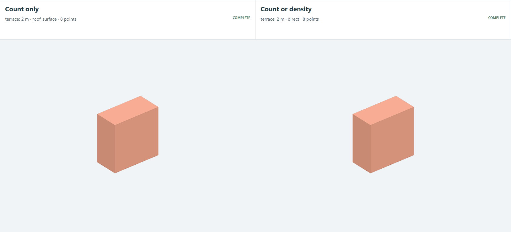

*Figure 5. A dashed footprint without a volume marks an unresolved body.*

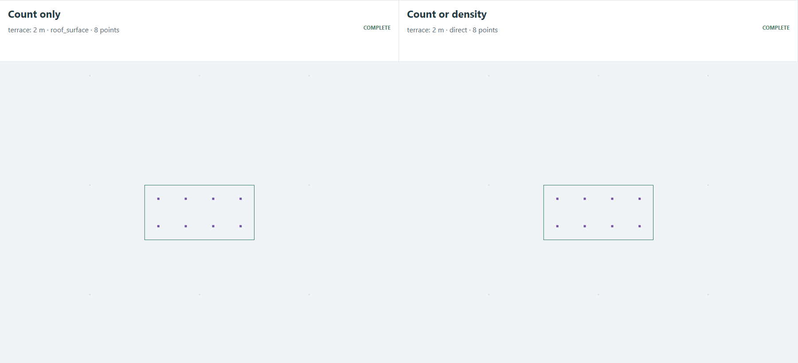

*Figure 6. Bright points are footprint candidates; faint points provide context. Colours are source labels, not roof ownership.*

| Variant | Body | Height above ground | Method | Roof points | Configuration | Model |
|---|---|---|---|---:|---|---|
| Count only | terrace | 2 m | Geometric surface | 8 | [JSON](../examples/parameters/density/configs/count.json) | [CityJSON](../examples/parameters/density/models/count.city.json) |
| Count or density | terrace | 2 m | LiDAR | 8 | [JSON](../examples/parameters/density/configs/density.json) | [CityJSON](../examples/parameters/density/models/density.city.json) |

[Download inputs, configurations and outputs](../examples/parameters/density/example.zip) · [Interactive comparison](../examples/parameters/preview.html?family=density)

## Supplied-height fallback

A main body has reliable LiDAR support; a small body has only two roof points
and a supplied 4 m height with provenance. Changing only
`external_height_fallback` from false to true resolves the small body from that
supplied height. The main body's 6 m LiDAR estimate remains unchanged, as shown
in Figure 7. The supplied value is an input, not an independent accuracy check.

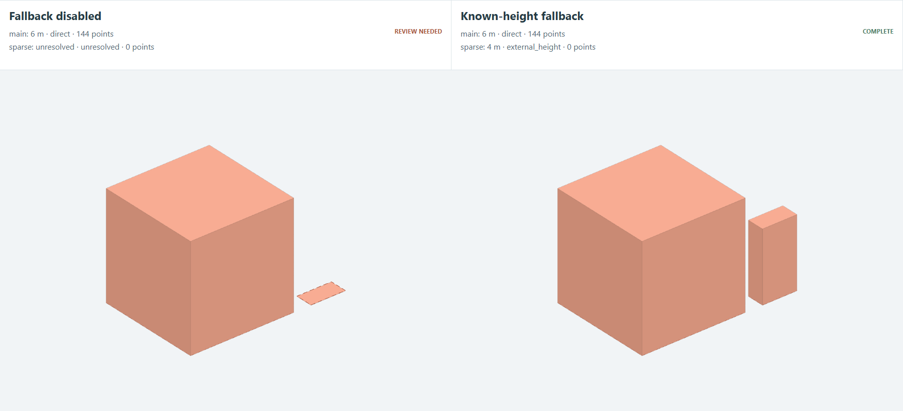

*Figure 7. A dashed footprint without a volume marks an unresolved body.*

| Variant | Body | Height above ground | Method | Roof points | Configuration | Model |
|---|---|---|---|---:|---|---|
| Fallback disabled | main | 6 m | LiDAR | 144 | [JSON](../examples/parameters/auxiliary/configs/off.json) | [CityJSON](../examples/parameters/auxiliary/models/off.city.json) |
| Fallback disabled | sparse | Unresolved | Unresolved | 0 | [JSON](../examples/parameters/auxiliary/configs/off.json) | [CityJSON](../examples/parameters/auxiliary/models/off.city.json) |
| Known-height fallback | main | 6 m | LiDAR | 144 | [JSON](../examples/parameters/auxiliary/configs/on.json) | [CityJSON](../examples/parameters/auxiliary/models/on.city.json) |
| Known-height fallback | sparse | 4 m | Supplied height | 0 | [JSON](../examples/parameters/auxiliary/configs/on.json) | [CityJSON](../examples/parameters/auxiliary/models/on.city.json) |

[Download inputs, configurations and outputs](../examples/parameters/auxiliary/example.zip) · [Interactive comparison](../examples/parameters/preview.html?family=auxiliary)

## Storey-height reference

The main body is 4 m high with two declared storeys. With
`height.min_floor_height_m: 2.5`, it is not accepted as a per-storey reference.
Lowering this setting to 1.5 accepts its 2 m/storey ratio, allowing a one-storey
body with only two observations to inherit a 2 m inferred height. Figure 8
shows this additional volume.

The independently measured 2 m terrace remains 2 m in both runs. This setting
selects storey references; it does **not** impose a minimum height on buildings
or raise low terraces. Choose plausible reference limits for your data.

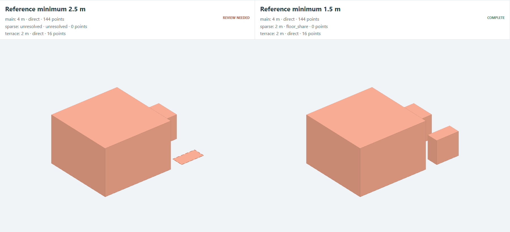

*Figure 8. A dashed footprint without a volume marks an unresolved body.*

| Variant | Body | Height above ground | Method | Roof points | Configuration | Model |
|---|---|---|---|---:|---|---|
| Reference minimum 2.5 m | main | 4 m | LiDAR | 144 | [JSON](../examples/parameters/floor-reference/configs/standard.json) | [CityJSON](../examples/parameters/floor-reference/models/standard.city.json) |
| Reference minimum 2.5 m | sparse | Unresolved | Unresolved | 0 | [JSON](../examples/parameters/floor-reference/configs/standard.json) | [CityJSON](../examples/parameters/floor-reference/models/standard.city.json) |
| Reference minimum 2.5 m | terrace | 2 m | LiDAR | 16 | [JSON](../examples/parameters/floor-reference/configs/standard.json) | [CityJSON](../examples/parameters/floor-reference/models/standard.city.json) |
| Reference minimum 1.5 m | main | 4 m | LiDAR | 144 | [JSON](../examples/parameters/floor-reference/configs/lower.json) | [CityJSON](../examples/parameters/floor-reference/models/lower.city.json) |
| Reference minimum 1.5 m | sparse | 2 m | Storey inference | 0 | [JSON](../examples/parameters/floor-reference/configs/lower.json) | [CityJSON](../examples/parameters/floor-reference/models/lower.city.json) |
| Reference minimum 1.5 m | terrace | 2 m | LiDAR | 16 | [JSON](../examples/parameters/floor-reference/configs/lower.json) | [CityJSON](../examples/parameters/floor-reference/models/lower.city.json) |

[Download inputs, configurations and outputs](../examples/parameters/floor-reference/example.zip) · [Interactive comparison](../examples/parameters/preview.html?family=floor-reference)

## Finding valid DTM ground

The DTM deliberately has NoData across the footprint and for 4 m around it.
`sampling.ground_buffers_m: [2]` finds no valid ground, so the building remains
unresolved despite its roof points. With `[2, 6]`, the second search reaches valid
terrain at Z = 25 m and the model resolves to 6 m above it. Figure 9 shows
the difference. Open the included DTM in a GIS application to inspect the NoData
strip; expanding a search does not fill missing raster cells or guarantee a
representative ground elevation on real slopes.

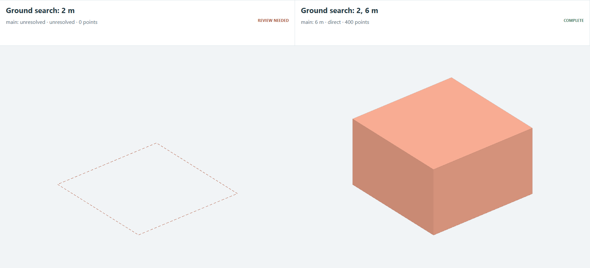

*Figure 9. A dashed footprint without a volume marks an unresolved body.*

| Variant | Body | Height above ground | Method | Roof points | Configuration | Model |
|---|---|---|---|---:|---|---|
| Ground search: 2 m | main | Unresolved | Unresolved | 0 | [JSON](../examples/parameters/ground/configs/short.json) | [CityJSON](../examples/parameters/ground/models/short.city.json) |
| Ground search: 2, 6 m | main | 6 m | LiDAR | 400 | [JSON](../examples/parameters/ground/configs/expand.json) | [CityJSON](../examples/parameters/ground/models/expand.city.json) |

[Download inputs, configurations and outputs](../examples/parameters/ground/example.zip) · [Interactive comparison](../examples/parameters/preview.html?family=ground)

## LoD0 and LoD1

A main body and a low terrace are reconstructed with `lods: [0]` and `[1]`.
Figure 10 shows the same source shapes as ground-level surfaces and as volumes.
LoD0 samples the DTM and needs no roof estimate. LoD1 adds walls and flat roofs
at the resolved part heights. Each output retains both parts and their parent.
In the interactive LiDAR-selection view, LoD0 has no selected roof observations.

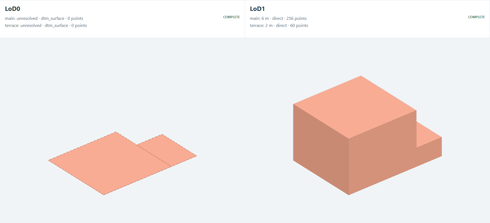

*Figure 10. The same bodies as ground-level surfaces and flat-roof volumes.*

| Variant | Body | Height above ground | Method | Roof points | Configuration | Model |
|---|---|---|---|---:|---|---|
| LoD0 | main | No volume (LoD0) | DTM | 0 | [JSON](../examples/parameters/lod/configs/zero.json) | [CityJSON](../examples/parameters/lod/models/zero.city.json) |
| LoD0 | terrace | No volume (LoD0) | DTM | 0 | [JSON](../examples/parameters/lod/configs/zero.json) | [CityJSON](../examples/parameters/lod/models/zero.city.json) |
| LoD1 | main | 6 m | LiDAR | 256 | [JSON](../examples/parameters/lod/configs/one.json) | [CityJSON](../examples/parameters/lod/models/one.city.json) |
| LoD1 | terrace | 2 m | LiDAR | 60 | [JSON](../examples/parameters/lod/configs/one.json) | [CityJSON](../examples/parameters/lod/models/one.city.json) |

[Download inputs, configurations and outputs](../examples/parameters/lod/example.zip) · [Interactive comparison](../examples/parameters/preview.html?family=lod)

## Water elevation percentile

One water polygon contains mostly observations at Z = 24 m and a higher tail
at Z = 25 m. Changing only `lifting.Water.percentile` from 10 to 90 produces
different common levels, shown in Figure 11. Both outputs remain horizontal.
The example illustrates selection sensitivity; it does not establish the correct
water level for a real survey. Check observation classes and the source before
choosing a percentile.

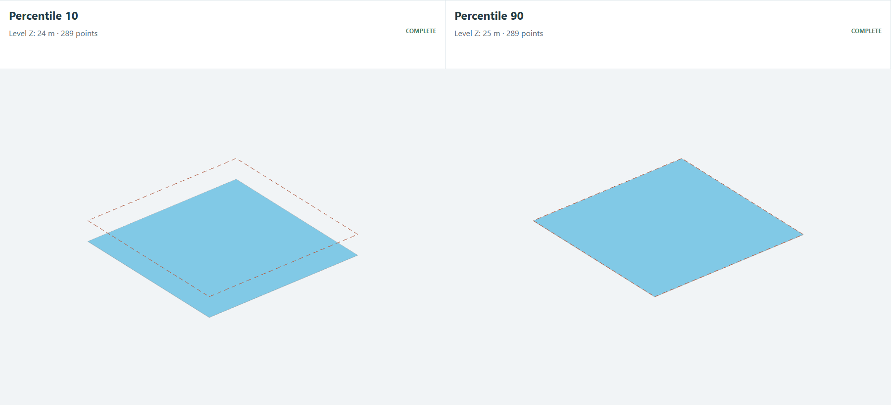

*Figure 11. Both water surfaces remain horizontal.*

| Variant | Output elevation | Changed vertices | Configuration | Model |
|---|---|---:|---|---|
| Percentile 10 | Z = 24.00 m | 0 | [JSON](../examples/parameters/water/configs/low.json) | [CityJSON](../examples/parameters/water/models/low.city.json) |
| Percentile 90 | Z = 25.00 m | 0 | [JSON](../examples/parameters/water/configs/high.json) | [CityJSON](../examples/parameters/water/models/high.city.json) |

[Download inputs, configurations and outputs](../examples/parameters/water/example.zip) · [Interactive comparison](../examples/parameters/preview.html?family=water)

## Road filtering and smoothing

A road boundary follows a gently sloping control plane with small elevation
variations and one deliberate +3 m spike. Figure 12 compares raw boundary
elevations, outlier replacement, and replacement of all vertices by the fitted
surface. The second run enables `road_filter_outliers`; the third also enables
`road_flatten`. The report records which vertices changed.

The fit acts on sampled boundary vertices. Its quality depends on the polygon
shape and observation support; smoothing is not a substitute for checking them.

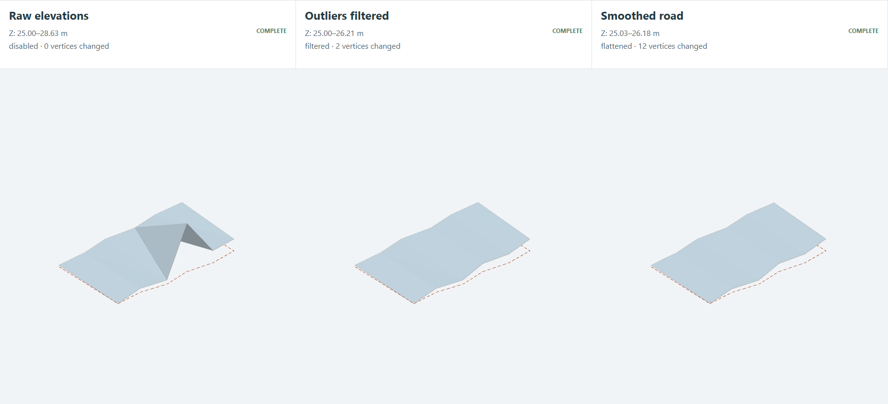

*Figure 12. Filtering replaces flagged outliers; smoothing replaces all boundary elevations.*

| Variant | Output elevation | Changed vertices | Configuration | Model |
|---|---|---:|---|---|
| Raw elevations | Z = 25.00–28.63 m | 0 | [JSON](../examples/parameters/road/configs/raw.json) | [CityJSON](../examples/parameters/road/models/raw.city.json) |
| Outliers filtered | Z = 25.00–26.21 m | 2 | [JSON](../examples/parameters/road/configs/filter.json) | [CityJSON](../examples/parameters/road/models/filter.city.json) |
| Smoothed road | Z = 25.03–26.18 m | 12 | [JSON](../examples/parameters/road/configs/smooth.json) | [CityJSON](../examples/parameters/road/models/smooth.city.json) |

[Download inputs, configurations and outputs](../examples/parameters/road/example.zip) · [Interactive comparison](../examples/parameters/preview.html?family=road)

## Recreate all example datasets

From an installed source checkout, choose a new directory:

```powershell
.\.venv\Scripts\python.exe tools/generate_parameter_examples.py --output outputs/parameter-examples-01
```

Each family contains `inputs`, `configs`, `models`, `evidence`, a summary and a
ZIP. Native engine reports are retained under `_runs` in the new output tree.
Inputs are read without modification during comparisons. The evidence files
identify measured, inferred and unresolved bodies separately.
