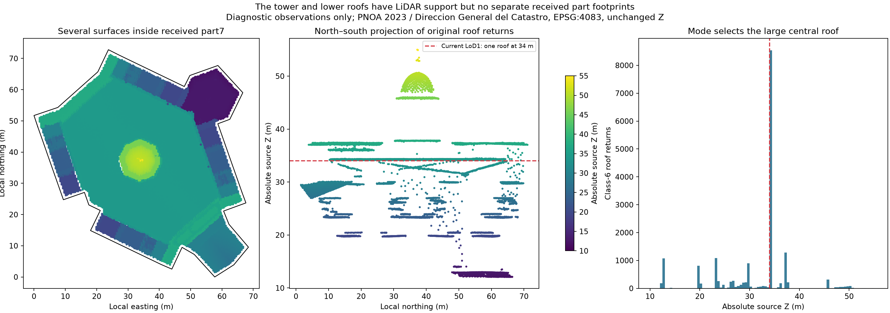
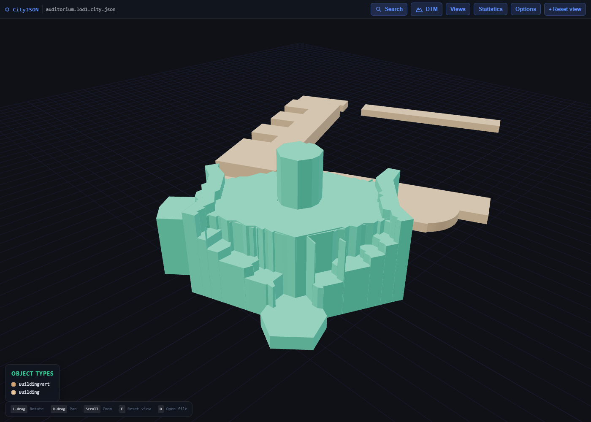

# Recover terraces within one footprint

A received building part can contain several roof levels without separate
footprints for its terraces, perimeter structures or tower. Assigning one
elevation to the entire part flattens those differences even when the LiDAR
observations describe them clearly. The optional `roof_regions` workflow
separates supported roof regions inside the original footprint and creates
several flat LoD1 volumes under the same source identity.

Figure 1 shows this situation in an auditorium. The original building-classified
returns distinguish the lower roofs and central tower within a single cadastral
part; a single dominant elevation represents only its large central roof.



*Figure 1. Working-CRS XY and absolute source Z. Coloured points are original
class-6 observations; the dashed line is the former single roof elevation.
PNOA LiDAR 2023, CC BY 4.0 scne.es; polygons: Direccion General del Catastro.*

[Open the observations at full size](../examples/roof_regions/roof-level-evidence.png).

## Enable internal roof regions

Add this fragment to a complete [building configuration](cli_reference.md):

```json
{
  "roof_classes": null,
  "roof_regions": {
    "enabled": true
  }
}
```

Run the usual build command with a new output directory:

```powershell
lodext build build.json --output results/roof-regions-01
```

This option requires LiDAR height estimation and LoD1. It checks fully covered,
bodies with an independent ground base and enough XYZ observations at several elevations. A previous single-roof solution is not required.
It supports direct LiDAR ground and the optional DTM workflow. Omission leaves
the existing single-roof behaviour unchanged.

For a targeted review, supply `roof_regions.object_ids` with a nonempty list of
exact class-qualified IDs, such as `BuildingPart::your-source-id`. Omit it or
use null to consider all eligible objects. Unknown IDs are rejected. Selection
limits the objects considered; it does not change their reconstruction criteria.

## Read the stepped model

Neighbouring observations at similar elevations can support one roof region. Each supported step becomes a flat volume above the part’s base. All volumes keep the original building-part ID and footprint extent.

The auditorium result in Figure 2 has several stepped perimeter roofs and a
separate central tower volume. The tower envelope is approximately **50.4 m
absolute Z**, above a base of **8.4 m**. These values share the source vertical
basis; they are not ellipsoidal heights for globe placement.



*Figure 2. Generated geometry in 3dLodViewer. The tower and terraces retain the
same source BuildingPart identity. Roofs remain flat approximations.*

[Open the detail](../examples/roof_regions/auditorium-detail.png) or
[view the full-scene context](../examples/roof_regions/auditorium-roof-regions.png).

Open the [small auditorium model](../examples/roof_regions/auditorium.lod1.city.json)
in a CityJSON viewer to inspect all seven received parts. Select the main part
and expand its attributes to inspect the inferred region evidence.

## Inspect evidence and limitations

Accepted objects have method `roof_regions`. Their `height_m` and
`reconstructed_top_z` describe the highest region, rather than every roof plane.
The `roof_regions` attributes in CityJSON and `quality.json` include the previous
method/elevation, support coverage, each inferred region footprint and its roof Z.
The received cadastral parts are not replaced by invented source identities.

Rejected attempts retain the previous geometry and an explicit reason.
Ground estimates, already resolved neighbouring objects and input point classes
are preserved. Increasing an XY-cell budget is explicit; exhaustion raises an error
instead of silently thinning observations.

Internal boundaries are inferred at the configured cell resolution. They are
not cadastral measurements. Occlusion, ambiguous surface ownership, roof
equipment and registration errors can still affect the result. Review the
regions against the original points. The method approximates connected inclined
or curved surfaces with flat envelopes; detailed curved or pitched geometry is
not generated. Several solids may belong to one CityObject, so counts of solids
and counts of identified parts differ.

## Common settings

Defaults belong to the configuration policy and are recorded in `run.json`.

| Setting | Default | Meaning |
|---|---|---|
| `cell_size_m` | `1.0` | XY observation cell size in metres |
| `layer_step_m` | `1.0` | Vertical layer size in source metres |
| `min_cell_points` | `2` | Returns required in an eligible cell/layer |
| `neighbour_height_m` | `1.5` | Largest height difference joining neighbouring cells |
| `min_region_cells` | `8` | Minimum connected cell count per supported region |
| `min_region_area_m2` | `8.0` | Minimum occupied support area in square metres |
| `min_level_separation_m` | `1.5` | Minimum elevation range across accepted regions |
| `min_coverage` | `0.6` | Minimum supported fraction of the sampling footprint |
| `max_extrapolation_m` | `3.0` | Limit on extending observed cell regions before boundary simplification |
| `simplify_m` | `0.75` | Simplification distance for inferred internal boundaries |
| `max_cells_per_object` | `100000` | Per-object XY cell budget |
| `max_total_cells` | `2000000` | Total retained XY cell budget |
| `max_layers_per_cell` | `16` | Columns exceeding this layer count become explicitly unusable |
| `max_regions` | `128` | Maximum output region count per source object |

Use a smaller cell size only when the source density supports it. More detail
increases memory, geometry size and processing time. A cell size does not improve
the accuracy of the original observations or footprint alignment.

If the report shows `unusable_vertical_cells`, inspect the points for competing elevations. When too little support remains, the output retains the previous flat volume or unresolved footprint.
