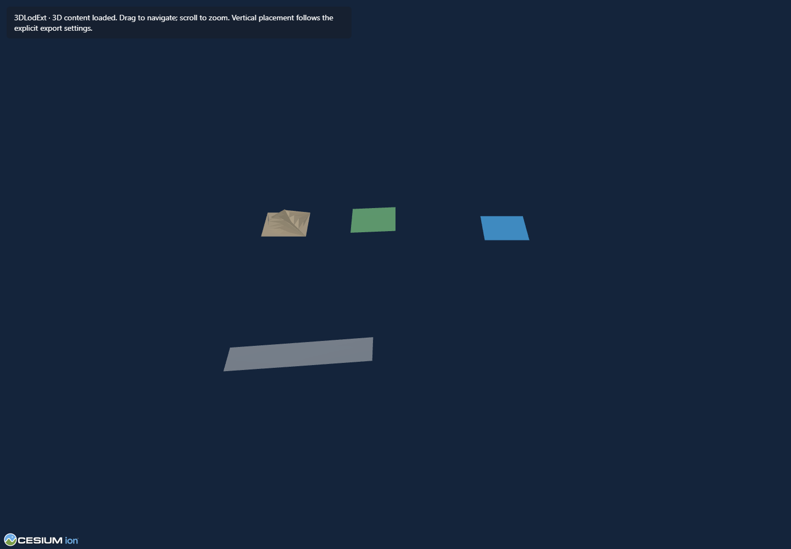

# Generate roads, terrain and water

The surface command lifts classified polygons using LiDAR. It preserves their
shape, holes and source identity. It processes surfaces separately from buildings;
neighbouring objects are not automatically joined into a continuous mesh.

A DTM can show the raised ground of a road or promenade without identifying it
as a transport object. A classified Road polygon supplies that identity and its
boundary. A building-only input therefore produces no Road objects, even when
the LiDAR contains ground returns on the pavement. Road width comes from the
supplied polygon; it is not inferred from a universal assumed width.

## Try the included example

The example contains a sloping road, a hill, forest ground and level water.
After [installation](installation.md), run:

```powershell
.\.venv\Scripts\python.exe -m lodext validate-surfaces examples/surfaces_first_run/surfaces.json
.\.venv\Scripts\python.exe -m lodext build-surfaces examples/surfaces_first_run/surfaces.json --output outputs/surfaces-first-run
```

Open `outputs/surfaces-first-run/model.surfaces.city.json` in a CityJSON viewer.
Expect four objects: Road, Terrain, Forest and Water. Figure 1 shows those
independent surfaces after conversion for Cesium.



*Figure 1. Synthetic road, terrain, forest-ground and water surfaces. The Forest
object represents ground, not individual trees.*

## Prepare your own polygons

Use an XY Polygon/MultiPolygon GeoPackage layer named `surfaces`, with a declared
CRS and these fields:

| Field | Requirement |
|---|---|
| `surface_id` | Nonempty TEXT, unique within its class |
| `surface_class` | Exactly `Road`, `Terrain`, `Forest` or `Water` |

Road width comes from the polygon. Terrain and forest-ground surfaces retain
interior elevation support; water receives one level per object. Bridges and
wall features are unsupported. Supply enough surrounding LiDAR for boundary
sampling, with elevations in metres and a compatible vertical reference.

A building-and-ground scene does not automatically run this surface stage.
Supply classified Road polygons and run `build-surfaces` to obtain Road objects.
The current commands do not automatically derive road outlines from ground
points or merge road surfaces into the building scene. Bridge-deck observations
alone are also not reconstructed as Bridge objects in this version.

Save a separate surface configuration beside the input files:

```json
{
  "config_version": "1",
  "surface_contract": "0.1",
  "dataset_id": "my-surfaces",
  "polygons": "footprints.gpkg",
  "lidar": ["lidar"],
  "working_epsg": 25828,
  "vertical_reference": "local_relative"
}
```

Choose a projected metric working CRS appropriate to your area; 25828 is an
example. Paths are relative to this JSON. This surface command samples LiDAR
directly and does not use a DTM; building reconstruction also supports direct
classified-point ground without a raster.
`local_relative` declares local height use without converting vertical datums.

## Adjust sampling when needed

By default, Road uses LAS classes 2/11 at percentile 50, Terrain/Forest classes
2/9 at percentile 50, and Water classes 2/9 at percentile 10. Check that your
source uses these classifications. To select only class 11 for roads, add this
to the configuration:

```json
{"lifting": {"Road": {"las_classes": [11]}}}
```

This is a fragment to add to the complete configuration, not a standalone file.
A null class selection accepts all classes; an empty list is invalid.

| Setting | When to use it |
|---|---|
| `layer` | Your polygon layer is not named `surfaces` |
| `radius_m` | Adjust the positive search radius around boundary vertices |
| `missing_vertices` | `nearest_ring` allows reported borrowing within a ring; `error` rejects missing boundary support |
| `road_filter_outliers`, `road_flatten` | Control road outlier filtering and quadratic smoothing |
| `max_outlier_fraction` | Limit the outlier fraction allowed in a road fit |
| `max_points_per_feature`, `max_tin_vertices` | Bound per-object processing; exceeding the budget stops the run |
| `chunk_points` | Adjust LiDAR read batches; large spatial queries can still require memory |
| `coverage_tolerance_m` | Tolerance around header bounds; does not create missing observations |
| `precision_m` | Output coordinate quantisation in metres, not source accuracy |
| `unresolved_objects` | `omit` keeps unresolved IDs/reports; `error` stops processing |

Review borrowed boundary heights and fit flags in `quality.json`. A whole ring
without observations remains unresolved. Use small areas first; this workflow
has mesh budgets and does not provide large-area terrain partitioning.

## Read and display the outputs

```text
model.surfaces.city.json   individual surfaces
quality.json              support, fit flags and object status
objects.csv               review table
run.json                  configuration and run summary
```

Use a new output directory each time. Exit code 0 means the surface stage
completed; 3 indicates partial output and 2 an error. Completion does not imply
that the separate objects share identical boundary heights.

To convert the example for Cesium:

```powershell
.\.venv\Scripts\python.exe -m lodext tiles outputs/surfaces-first-run/model.surfaces.city.json --output outputs/surfaces-first-tiles --z-offset-m 0
```

Zero is a deliberate display choice for this synthetic example. For real data,
choose vertical placement using [the Cesium guide](cesium.md). With its local
HTTP server running, open:

```text
http://127.0.0.1:8012/examples/cesium-preview.html?tileset=/outputs/surfaces-first-tiles/tileset.json
```
