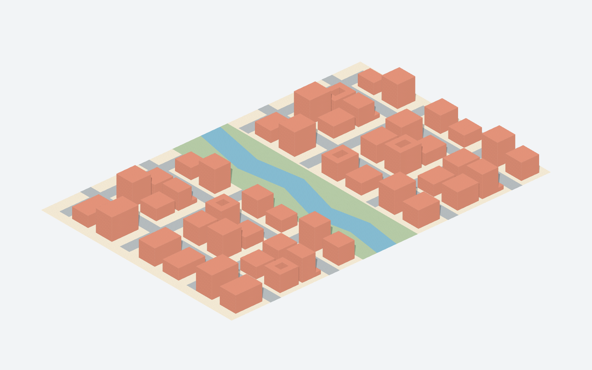

# From a GIS map to a 3D neighbourhood



An original synthetic example for explaining the reconstruction process. All
source polygons, LiDAR observations, DTM values, generated models and artwork
are original project material under [MIT](../../LICENSE). No upstream screenshot,
real survey or private dataset is included.

## What the image contains

| Input / result | Content |
|---|---|
| Extent | 180 × 120 m in a metric working CRS, EPSG:25828 |
| Buildings | 48 parents, 53 parts; courtyards and genuine low terraces included |
| Building output | All 53 parts resolved by direct estimation; 53 LoD1 solids, no exclusions |
| Surface output | 2 Roads, 1 Water, 2 Forest and 188 Terrain objects; all 193 resolved |
| Surface triangulation | 5,288 triangles; individual objects without scene stitching |
| DTM | Constant elevation 25 m, 0.5 m pixels, explicit local vertical reference |
| Roof observations | Uniform nominal 5 points/m²; spacing `1 / sqrt(5)` m |
| Ground observations | Separate 2 m grid plus explicit boundary controls on Terrain/Forest rings |

Roof points are classified as 6. Ground controls are class 2; road/water grid
observations use classes 11/9. One building has a deliberate high tail: every
seventh roof observation is raised 8 m to illustrate a supported dominant peak.
This is a controlled teaching fixture, not a reproduction of an upstream engine's
output or a density/accuracy comparison. A regular grid and perfect flat DTM do
not represent survey noise, registration error, real occlusion or terrain slope.

The figure **composes two actual 3DLodExt runs** in their original coordinates:
building LoD1 and individual lifted surfaces. It does not join their boundaries,
add hidden connectors or change the heights. Separations and bridges are absent.
The complete seven-class minimum is still pending.

## Inspect the stages

[Open the interactive preview](preview.html). Switch between classified 2D
polygons, actual synthetic observations and generated geometry; drag to orbit
and scroll to zoom. Serve this directory over HTTP rather than opening it as
`file://`. The optional preview fetches Three.js 0.128.0 from jsDelivr; it needs
network access and a browser with WebGL. Static figures and reconstruction do
not require this browser dependency.

The checked-in models can also be opened in a CityJSON viewer:

- [Building model](model.buildings.city.json)
- [Surface model](model.surfaces.city.json)
- [Run summaries](showcase.json)

`presentation.json` contains display triangles derived from those models,
original source-map rings and the visible observations. Rendering subtracts a
declared common origin `(500000, 3100000, 25)` for local precision; the display
maps source Z to the viewer's up axis without vertical exaggeration. Colours,
lighting and the camera are presentation choices, not reconstructed attributes.
Preview shadows are illustrative lighting, not an analysis product.

## Reproduce

Install [the geospatial environment](../../docs/installation.md). From the
repository root, choose a **new** output directory:

```powershell
.\.venv\Scripts\python.exe tools/generate_showcase.py --output outputs/showcase-01
```

The tool generates its own inputs and calls the same building/surface pipelines
used by the CLI. It refuses an existing output directory and stops if either
stage reports unresolved objects. It does not require a service or database.
The fixture uses an explicit 2.1 m surface sampling radius and 0.0001 m output
precision for its narrow polygons; these are fixture settings, not new defaults.

To view a new run, serve the repository root locally and open
`examples/showcase/preview.html?data=../../outputs/showcase-01/presentation.json`.
The preview's `step` query selects `map`, `points` or `model`; absent `step`
selects `model`. `capture=1` hides the interface for image capture. Any other
`capture` value keeps it visible. `data` is a browser-fetchable presentation JSON
URL, relative to the preview; absent `data` uses the checked-in `presentation.json`.
These options affect the preview only, never reconstruction settings.

Read [the visual process chapter](../../docs/how_it_works.md) for the method,
sampling schematic, shadow-height motivation and required stitching behaviour.
